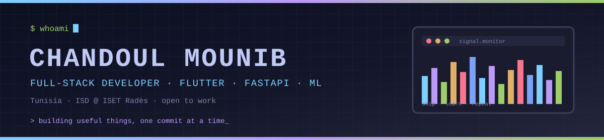

  

## 👋 Hey, I'm Mounib

I'm an **IT Engineering student (ISD @ ISET Radès)** and a **full-stack developer** based in Tunisia. I like building things that connect a solid backend with a genuinely nice mobile experience — REST APIs, Flutter apps, and increasingly, machine learning.

Right now I'm sharpening my ML skills while shipping self-hosted tools and finishing up internship-grade projects.

### ⚡ At a glance

| | |
|---|---|
| 🎓 | **ISD student** — ISET Radès, Tunisia |
| 💻 | **Focus** — Flutter, FastAPI, REST API design |
| 🤖 | **Learning** — machine learning & algorithmic trading |
| 💼 | **Status** — open to work and internship opportunities |

---

## 🚀 Featured projects

<table>
  <tr>
    <td width="50%" valign="top">
      <a href="https://github.com/Mounib-Chandoul/Taste"><b>🎵 Taste — Music Lab</b></a> 
      Self-hosted, LAN-first music streaming. FastAPI + SQLite FTS5 trigram search, Range streaming, ETag sync, and a Pixel-style Flutter client with offline downloads.  
      
      
      
    </td>
    <td width="50%" valign="top">
      <a href="https://github.com/Mounib-Chandoul/Fitness-Flutter-App"><b>🏋️ Fitness Flutter App</b></a> 
      2nd-year internship project — a Flutter fitness tracking app backed by a REST API. Graded <b>17.05/20</b>.  
      
      
    </td>
  </tr>
  <tr>
    <td width="50%" valign="top">
      <a href="https://github.com/Mounib-Chandoul/First-Angular-Project"><b>🎓 Training Management System</b></a> 
      Angular 21 web app for ISET Radès — public course browsing and enrollment, plus a private admin dashboard for trainers, sessions and candidates.  
      
      
    </td>
    <td width="50%" valign="top">
      <a href="https://github.com/Mounib-Chandoul/Ai_Trader_XAUUSD"><b>📈 AI Trader XAU/USD</b></a> 
      Learning ML through algorithmic trading — predictive signals and risk-management logic on gold.  
      
      
    </td>
  </tr>
</table>

**More repos:** [AlphaFeed](https://github.com/Mounib-Chandoul/AlphaFeed) (my first SaaS platform) · [MyPortfolio](https://github.com/Mounib-Chandoul/MyPortfolio) · [JEE Learning Project](https://github.com/Mounib-Chandoul/JEE_LearningProject) · [JavaFX Learning](https://github.com/Mounib-Chandoul/JavaFX-Learning)

---

## 🛠 Tech stack

  
  
  
  
  
  
  

  
  
  
  
  
  

---

## 📈 Activity

  

---

## ✉️ Let's connect

  
  
  

---

  
    
  Thanks for stopping by — star a repo if something caught your eye ⭐

